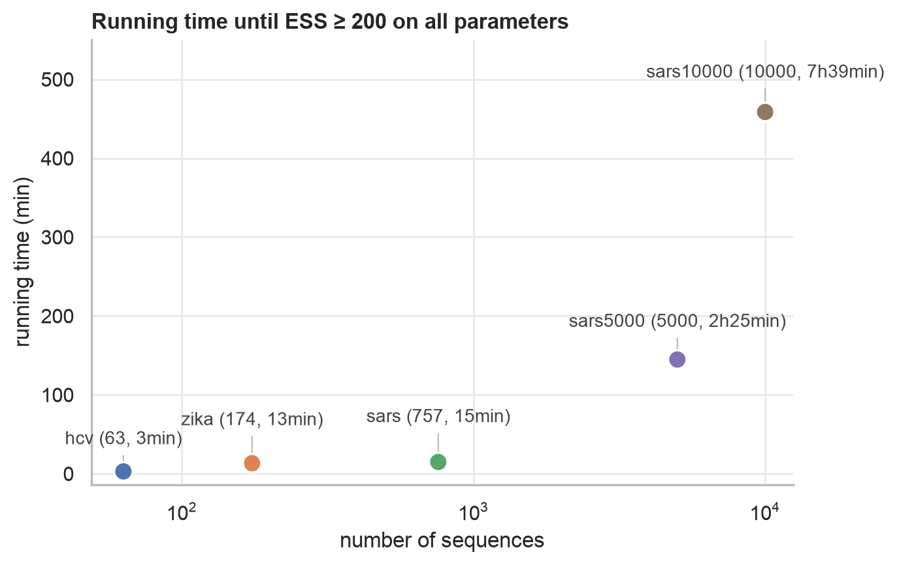

## EMATs for BEAST 2

This project adds an implementation of Explicitly Annotated Mutation Trees (EMATs) into the BEAST 2 framework. It was heavily inspired by Delphy.

## Convergence Time

Running time until an ESS of at least 200 is reached on all parameters, for datasets of increasing size.

## Package Overview

| Package                         | Description                                                                                    |
|---------------------------------|------------------------------------------------------------------------------------------------|
| `emat.state`                    | `Mutations` and `Mutation`: the mutations annotated on the branches of the tree.               |
| `emat.prior`                    | `GeneticPrior`: the genetic prior of the mutations (evolutionary model).                       |
| `emat.operators.topology`       | Subtree moves that change the tree topology; `mdspr` holds the buffer of mutation-directed SPR.   |
| `emat.operators.nodetimes`      | Moves that change node heights; `batch` holds the batch displacement and its learned tree prior, `warp` the learned warp. |
| `emat.operators.mutations`      | Moves that only change the mutation histories on the branches.                                 |
| `emat.stochasticmapping`        | Stochastic mapping of site histories (Jukes-Cantor, uniformised), and the samplers built on it. |
| `emat.helper`                   | Shared helpers such as Fitch parsimony, mutation paths and site changes.                       |
| `emat.initalisation`            | `ParsimonyMutationsInitialiser`: initialises the mutations from a parsimony reconstruction.    |
| `emat.alignment`, `emat.tree`   | Alignment filtering and tree interval utilities.                                               |
| `emat.benchmark`                | `TimedMCMC`: MCMC with timing for benchmarks.                                                  |

## Operators

All operators keep the mutations on the tree consistent, and are grouped by what they change.

**Topology (`emat.operators.topology`)**

| Operator                      | Description                                                                                              |
|-------------------------------|----------------------------------------------------------------------------------------------------------|
| `SubtreePruneRegraftOperator` | Abstract base of the subtree moves below; resamples the history on the affected branches.                |
| `MutationDirectedSprOperator` | Regrafts a subtree preferably where the sequences are similar, using the mutations as a parsimony map. The subtree is picked uniformly or in proportion to its branch length. |

**Node times (`emat.operators.nodetimes`)**

| Operator                        | Description                                                                                              |
|---------------------------------|----------------------------------------------------------------------------------------------------------|
| `InnerNodeDisplacementOperator` | Moves an internal node within the range allowed by the mutations on its adjacent branches.               |
| `BatchNodeDisplacementOperator` | Displaces a batch of internal nodes at once, using a learned approximation of the tree prior.            |
| `RootScaleOperator`             | Scales the shorter root branch, which moves the root height.                                             |
| `IntervalScaleOperator`         | Scales all intervals between nodes and their older children, keeping the tree valid for serial samples.  |
| `LearnedWarpOperator`           | Jointly moves the tree prior parameters, all internal node heights and the clock rate, using a time change learned from the chain. |

**Mutations (`emat.operators.mutations`)**

| Operator                    | Description                                                                                              |
|-----------------------------|----------------------------------------------------------------------------------------------------------|
| `MutationTimeOperator`      | Moves a single mutation between its neighbouring events at the same site.                                |
| `BranchReformOperator`      | Resamples the mutation history of a branch without changing the tree.                                    |
| `SiteHistoryGibbsOperator`  | Resamples the complete history of a site by stochastic mapping.                                          |
| `MissingCladeGibbsOperator` | Resamples the history of the clades whose data is missing around a tip.                                  |
